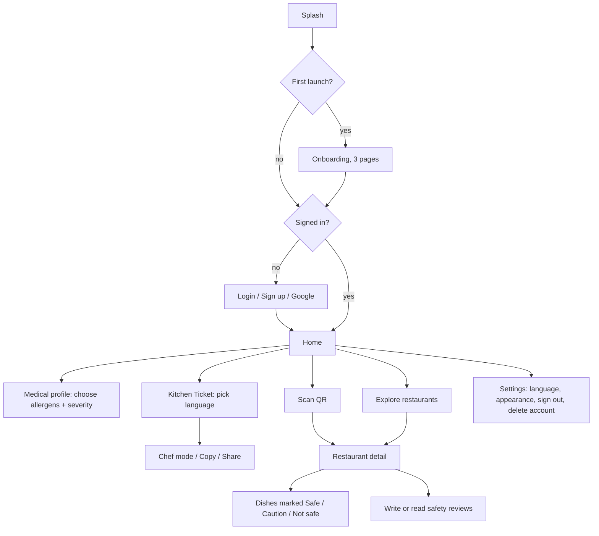

# Mi-Dine Design Documentation

## Design direction

- **Identity:** a stethoscope wrapped around a fork. Calm, clinical and trustworthy, with warmth from rounded shapes.
- **Palette:** logo teal `#0B5560` as the brand colour. Green `#2E9E6B`, amber `#E8A317` and red `#D64545` appear only to communicate safety, so they keep their meaning.
- **Typography:** Poppins for headings, Inter for body text.
- **Components:** 14 to 24 px rounded corners, hairline borders instead of heavy shadows, 8 pt spacing grid, Cupertino icons, no emoji.
- **Modes:** light and dark. The Kitchen Ticket is always white so a chef can read it clearly.
- **Motion:** purposeful only: splash sequence, onboarding page indicator, ticket cross-fade between languages, Hero from restaurant card to detail, skeleton loaders, button-to-spinner morph.

## User flow



## Wireframes (key screens)

```
HOME                         PROFILE                      KITCHEN TICKET
+----------------------+     +----------------------+     +----------------------+
| Good morning    (S)  |     | Medical profile  (*) |     | Kitchen Ticket       |
| Hello, Name          |     | Select what you      |     | [EN][ES][FR][AR][ZH] |
| +------------------+ |     | must avoid.          |     | +------------------+ |
| | 3 triggers saved | |     | [+ Peanuts] [Gluten] |     | | MEDICAL ALERT    | |
| | (pills)          | |     | [Dairy]   [Soy]      |     | | ANAPHYLACTIC     | |
| +------------------+ |     | [Shellfish] [Eggs]   |     | |  Peanuts         | |
| +--------+ +-------+ |     |                      |     | |  - no contact    | |
| | Ticket | |Explore| |     | tap -> severity      |     | +------------------+ |
| |        | +-------+ |     | sheet:               |     | [ Show to chef ]     |
| |        | |Scan QR| |     |  Anaphylactic        |     | [Copy]   [Share]     |
| +--------+ +-------+ |     |  Severe              |     +----------------------+
| Restaurants  See all |     |  Preference          |
| [card] [card] [card] |     |  Remove              |
+----------------------+     +----------------------+

RESTAURANT DETAIL            REVIEW SHEET
+----------------------+     +----------------------+
| < Tokyo Garden       |     | Write a safety review|
| (T) Japanese         |     | * * * * *            |
| [Safe 2][Caution 1]  |     | Dedicated fryer  [o] |
| [Not safe 1]         |     | Staff understood [o] |
| Menu     Safe only[o]|     | [ comment ........ ] |
| Teriyaki  NOT SAFE   |     | [ Post review ]      |
|  Contains Soy        |     +----------------------+
| Nigiri    NOT SAFE   |
+----------------------+
```

Final high-fidelity designs are the screenshots in `docs/screenshots/`.